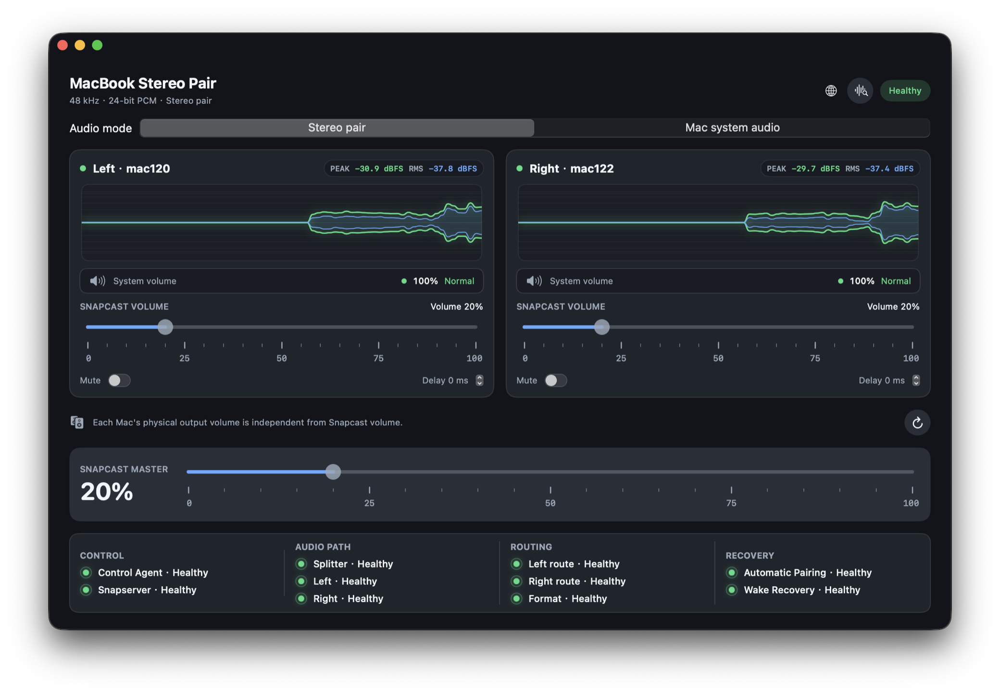
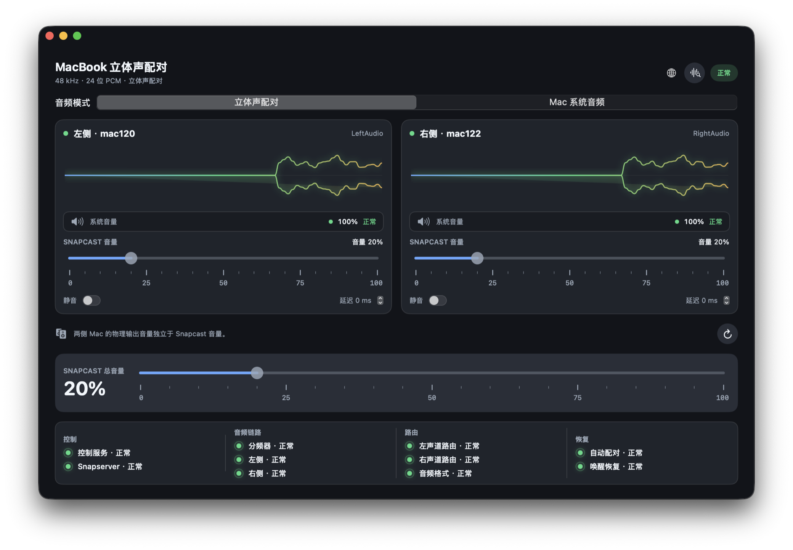

# MacBook Stereo Pair for macOS

> Turn two Macs into a synchronized, lossless left/right stereo pair for macOS
> system audio.

[](https://github.com/damoqiongqiu/snapcast-stereo-pair/actions/workflows/ci.yml)
[](LICENSE)

MacBook Stereo Pair is a self-contained macOS audio runtime built on Snapcast.
It captures system audio once through BlackHole, splits it into synchronized
left and right mono streams, and plays each side on the corresponding Mac. A
native SwiftUI console, owner-only control Agent, installation lifecycle, and
automatic device recovery replace the manual setup normally required for a
multiroom audio stack.



<sub>Current native console: live stereo meters, continuous volume controls,
dual-Mac system-volume indicators, and end-to-end runtime health.</sub>

<details>
<summary>简体中文界面</summary>



</details>

## 1. At a Glance

| Property | Project behavior |
| --- | --- |
| Primary use case | Two-MacBook left/right stereo for macOS system audio |
| Platform | macOS 14 or newer; Intel and Apple Silicon builds supported |
| Audio transport | Snapcast with uncompressed 48 kHz / 24-bit mono PCM streams |
| Timing | One capture clock, 20 ms Snapcast chunks, 200 ms default stream buffer |
| Audio capture | BlackHole 2ch through PortAudio |
| Playback | Patched Snapclient with explicit CoreAudio device selection |
| Control surface | Native SwiftUI Dock and menu-bar application |
| Volume control | Continuous side/master sliders with throttled asynchronous audio previews |
| Physical placement | Symmetric left/right placement around the primary listening position |
| Network boundary | Stream TCP `1704`; control APIs bound to localhost |
| Recovery | Sleep/wake relaunch, hardware-volume recovery, health monitoring |
| Release model | Ad-hoc signed source builds and Homebrew packaging |
| License | GPL-3.0-or-later |
| Upstream base | Snapcast `v0.35.0` |

## 2. Why This Fork

Upstream Snapcast provides the synchronization engine. This project packages
the macOS-specific work needed to run a practical two-Mac stereo pair.

| Requirement | Raw Snapcast setup | MacBook Stereo Pair |
| --- | --- | --- |
| macOS system-audio capture | Assemble separately | BlackHole capture and left/right FIFO split built in |
| Left/right role mapping | Configure generic clients | Stable role-based `LeftAudio` and `RightAudio` routing |
| Local playback device | Choose manually | Explicit CoreAudio output binding with feedback-safe routing |
| Volume interaction | Control through external tools | Native continuous sliders with synchronized side/master updates |
| Volume safety | Manage external scripts | Preserve and restore hardware output and exact volume |
| Sleep/wake recovery | Build separately | Local and remote wake-recovery LaunchAgents included |
| Control interface | Use an external client | Native SwiftUI console with live meters and diagnostics |
| Install and upgrade | Reproducible manual steps | Manifest-driven installer, repair, upgrade, and force reinstall |

## 3. Quick Start

### 3.1 Prerequisites

- Two Macs running macOS 14 or newer on the same trusted LAN or VPN.
- An SSH account on the remote Mac. The setup wizard can create or install a key
  when key-only access is not configured yet.
- Homebrew and Xcode Command Line Tools on the source Mac.
- BlackHole 2ch on the source Mac.
- The same CPU architecture on both Macs when using the included remote
  installer to copy the locally built Snapclient binary.

```sh
brew install --cask blackhole-2ch
brew install switchaudio-osx portaudio cmake ninja pkgconf boost openssl@4 \
  flac libogg libsoxr libvorbis opus
```

Run all installation and configuration commands on the Mac that will capture
system audio. This documentation calls it the **source Mac**.

### 3.2 Physical Placement

Place the two Macs symmetrically to the listener's left and right. Symmetry has
a larger effect on the center image than small differences in absolute speaker
distance:

- Keep both Macs at approximately the same distance from the primary listening
  position and keep the listener near the center line between them.
- Use the same height and orientation for both Macs, with the built-in speakers
  facing the listening position.
- Avoid placing only one Mac against a wall, in a corner, behind furniture, or
  on a materially different surface; asymmetric reflections can pull the image
  to one side.
- Keep the left and right Snapcast levels equal, and leave both physical output
  stages at 100%.
- A near-equilateral triangle between the two Macs and the listener is a useful
  starting point. Adjust the width and inward angle using centered vocals and
  hard-panned instruments until the center image is stable and in front.

Snapcast synchronizes the playback timelines, but it cannot remove acoustic
path-length differences, room reflections, or other effects caused by
asymmetric placement. See [docs/architecture.md](docs/architecture.md) for the
timing and acoustic boundaries.

### 3.3 Source Material and Playback Effects

The pair reproduces what macOS applications send to the source Mac. Use clean
stereo material when judging placement or sound quality:

- Prefer lossless recordings or high-bitrate stereo streams. Lossy compression
  can still sound good, but it is a less reliable reference for cymbals, reverb
  tails, and low-level detail.
- Disable spatial audio or headphone virtualization, equalizers, loudness
  normalization, crossfade, and per-application audio effects during evaluation.
  These can alter panning, dynamics, bass, or delay before the stream is created.
- Leave player and application volume controls at their normal full or 0 dB
  setting, then adjust listening volume with the native console. Avoid stacking
  several digital volume stages.
- Use familiar stereo recordings containing a stable centered vocal, clearly
  hard-panned instruments, and natural reverb. Mono material is useful for
  checking center focus, but it cannot validate stereo width or left/right
  balance.
- Compare the same passage in the stereo pair and native macOS audio. Prefer
  sources that are already known to produce a stable, natural image on the
  source Mac by itself.

### 3.4 Option A: Native Setup Wizard

```sh
git clone https://github.com/damoqiongqiu/snapcast-stereo-pair.git
cd snapcast-stereo-pair

./integration/scripts/install-product.sh
open "$HOME/Applications/MacBook Stereo Pair.app"
```

In the wizard:

1. Check external dependencies.
2. Complete local runtime installation when prompted.
3. Enter the remote Mac's SSH user and hostname or address.
4. Allow Terminal to configure key authentication and install the remote client.
5. Return to the app and verify that both channels are connected.

Password-requiring steps remain in Terminal. The app does not read or store the
local administrator password or remote SSH password.

The wizard uses the default layout with the **remote Mac physically on the
left**. Use the CLI path if the source Mac is physically on the left or if the
output devices need non-default UIDs.

### 3.5 Option B: CLI Configuration

Use this path for explicit control over physical placement and device config:

```sh
git clone https://github.com/damoqiongqiu/snapcast-stereo-pair.git
cd snapcast-stereo-pair

./integration/scripts/configure-pair.sh
./integration/scripts/install-product.sh
./integration/scripts/install-remote.sh
./integration/scripts/check-health.sh

open "$HOME/Applications/MacBook Stereo Pair.app"
```

`configure-pair.sh` asks for:

- the remote Mac's SSH user;
- the remote Mac's hostname or address;
- the source Mac's address, or blank for auto-detection;
- whether the remote Mac is physically on the left.

It writes the resolved configuration to
`~/.config/snapcast-stereo-pair/pair.env`. Device names and UIDs can be
overridden through environment variables or by editing that file before
installation. Environment variables take precedence during configuration.

For a non-interactive configuration:

```sh
PAIR_NONINTERACTIVE=1 \
REMOTE_USER="<ssh-user>" \
REMOTE_HOST="<remote-host>" \
SOURCE_HOST="" \
LEFT_IS_REMOTE=true \
./integration/scripts/configure-pair.sh --print
```

Remove `--print` after checking the resolved values.

For detailed prerequisites and manual configuration, see
[docs/installation.md](docs/installation.md).

## 4. Native macOS Console

The console is the supported graphical control surface for this repository. It
is a normal Dock application with a menu-bar entry and remains independent from
the audio engine: closing the window or quitting the GUI does not stop playback.

Key capabilities:

- Dual-channel live waveforms, peak/RMS meters, and clip indication.
- Per-side and master Snapcast volume with continuous pointer tracking,
  throttled asynchronous audio previews, trailing final commits, synchronized
  master changes, and aligned 5% visual scales.
- Separate physical system-volume indicators for both Macs.
- Mute, latency, stream format, route, and connection state controls.
- Service, routing, pairing, and wake-recovery health.
- Stereo-pair and normal macOS-audio mode switching.
- Redacted diagnostics, allowlisted service restarts, and installation repair.
- English and Simplified Chinese resources; new installs default to English.
- Single-instance protection, a non-scrolling dashboard with a minimum window
  size that keeps every card visible, keyboard-adjustable volume controls, and
  accessible status text.

See [docs/native-console.md](docs/native-console.md) for the complete control
model, recovery behavior, accessibility, and privacy design.

## 5. How the Stereo Pair Works

```text
macOS applications
        |
        v
BlackHole 2ch
        |
        | PortAudio, 10 ms capture callbacks
        v
snapcast-capture-blackhole
        |
        +---- left.pcm FIFO ----> LeftAudio ----> left-side Mac
        |
        +---- right.pcm FIFO ---> RightAudio ---> right-side Mac
```

One capture process writes both mono FIFOs from the same callback, preserving a
shared source clock and block boundary. Snapserver timestamps both streams using
one clock. Each Snapclient expands its mono stream to the two channels of its
explicit CoreAudio output device.

Listening volume is applied after decoding through
`AudioQueueSetParameter`. The integer PCM network buffer remains at full scale.
BlackHole and the physical speaker stages are normalized independently.

See [docs/architecture.md](docs/architecture.md) for timing, routing, recovery,
network, CoreAudio, and acoustic-limit details. Physical placement still
affects path length, reflections, and the perceived stereo image even when the
playback timelines are synchronized.

## 6. Installation and Operations

The product installer is idempotent and manifest-driven:

- Verified same-version installs are no-ops.
- Missing or changed files are repaired.
- Newer versions are installed as upgrades.
- Accidental downgrades fail unless force reinstall is explicit.
- Force reinstall preserves configuration, remote control state, logs, and
  preferences.
- Configuration clearing remains a separate destructive operation.

Common commands:

```sh
# Reconcile the installation without changing files or services.
./integration/scripts/install-product.sh --dry-run

# Rebuild and replace all programs and services while preserving state.
./integration/scripts/install-product.sh --force-reinstall

# Inspect the agent snapshot.
"$HOME/Library/Application Support/Snapcast/bin/mac-stereo-pairctl" status

# Read redacted diagnostics.
"$HOME/Library/Application Support/Snapcast/bin/mac-stereo-pairctl" diagnostics

# Return the source Mac to its saved normal audio configuration.
"$HOME/Library/Application Support/Snapcast/set-mode.sh" native
```

Installation state is stored at:

```text
~/Library/Application Support/Snapcast/state/installation.json
```

Pairing configuration is stored outside the repository at:

```text
~/.config/snapcast-stereo-pair/pair.env
```

Logs are written under:

```text
~/Library/Logs/Snapcast/
```

## 7. Agent Quick Reference

AI coding agents should read [AGENTS.md](AGENTS.md) before modifying the
repository.

### 7.1 Source of Truth

| Task | Read or use |
| --- | --- |
| Pairing values | [integration/scripts/pair-config.sh](integration/scripts/pair-config.sh) |
| Audio routing | [integration/scripts/ensure-pair-routing.sh](integration/scripts/ensure-pair-routing.sh) |
| Native control model | [native/Sources/StereoPairCore](native/Sources/StereoPairCore) |
| Native UI | [native/Sources/MacStereoPair](native/Sources/MacStereoPair) |
| Installation lifecycle | [integration/scripts/install-lifecycle.sh](integration/scripts/install-lifecycle.sh) |
| Architecture | [docs/architecture.md](docs/architecture.md) |
| Troubleshooting | [docs/troubleshooting.md](docs/troubleshooting.md) |

### 7.2 Required Verification

[AGENTS.md](AGENTS.md) is the canonical release checklist. Run every check that
covers the change and use the complete list before a release. Documentation-only
changes must at least pass:

```sh
./scripts/check-public-tree.sh
git diff --check
```

### 7.3 Safety Rules

- Never execute a user-editable `pair.env` as shell source.
- Never accept executable paths or shell fragments over the control socket.
- Keep control APIs bound to localhost.
- Never expose stream port `1704` beyond a trusted LAN or VPN.
- Do not add lossy codecs or resampling without measured quality and latency
  evidence.
- Do not fold configuration deletion into force reinstall.
- Redact diagnostics by default and never upload them automatically.

For machine-readable project context, see [llms.txt](llms.txt).

## 8. Requirements and Compatibility

- macOS 14 or newer on both Macs.
- BlackHole 2ch on the source Mac.
- The same CPU architecture on both Macs when using the bundled remote installer
  to copy a locally built Snapclient binary.
- Snapcast upstream base: `v0.35.0`.
- Current native runtime: `v0.2.0`.

The primary validated environment is two MacBook Pro `Mac16,1` systems with
Apple M4, 24 GB and 16 GB memory, macOS 27.2.1, and BlackHole 2ch 0.7.1.

## 9. Security Boundaries

- Snapcast stream TCP `1704` is unauthenticated and requires a trusted LAN,
  VPN, or restrictive firewall.
- Snapserver HTTP and TCP control APIs are bound to localhost.
- The native control socket is owner-only (`0600`) and validates peer UID.
- Diagnostics are redacted by default.
- The project never disables Gatekeeper, SIP, or another macOS security feature.
- Releases are ad-hoc signed; no Developer ID, App Store dependency, root
  helper, or automatic updater is required.

Read [SECURITY.md](SECURITY.md) before reporting a vulnerability.

## 10. FAQ

### Is the audio lossless?

Yes. The default path uses uncompressed 48 kHz / 24-bit mono PCM for each side.

### Does it replace the upstream Snapcast project?

No. It is an unofficial macOS-focused runtime and integration layer built on
Snapcast. Upstream Snapcast remains the synchronization engine.

### Does it support Intel Macs?

The configuration and build scripts support Intel and Apple Silicon Homebrew
prefixes. Both Macs should use the same CPU architecture when relying on the
included remote binary-copy workflow.

### How much latency does it add?

The validated default uses 20 ms Snapcast chunks and a 200 ms stream buffer.
Smaller buffers may reduce latency but increase underrun risk on Wi-Fi.

### Does sleep or wake break the pair?

Wake-recovery LaunchAgents recreate invalidated CoreAudio queues, restore
routing and hardware volume, and restart capture or playback as needed.

## 11. Troubleshooting

Start with:

```sh
./integration/scripts/check-health.sh
```

Then inspect:

- Both channel sample formats as `48000:24:1`.
- Hardware capture and output volumes as `100.00%`.
- `LeftAudio` and `RightAudio` client routing.
- Recent underrun or resynchronization warnings in `~/Library/Logs/Snapcast/`.
- The native console's routing, service, and recovery status.

See [docs/troubleshooting.md](docs/troubleshooting.md) for recovery procedures.

## 12. Development

The repository contains both the macOS integration layer and the patched
Snapcast sources:

| Path | Purpose |
| --- | --- |
| `client/` | Patched Snapclient CoreAudio output |
| `server/` | Snapserver sources |
| `integration/capture/` | BlackHole capture, PCM split, and metrics |
| `integration/config/` | Configuration templates |
| `integration/launchagents/` | Per-user service templates |
| `integration/scripts/` | Install, routing, mode, health, and maintenance |
| `integration/test/` | Integration and lifecycle tests |
| `native/` | Swift console, Agent, CLI, setup, packaging, and tests |
| `docs/` | Architecture, installation, security, and maintenance documentation |

Read [CONTRIBUTING.md](CONTRIBUTING.md) before submitting changes.

## 13. Uninstall and Rollback

Return the source Mac to normal local audio:

```sh
"$HOME/Library/Application Support/Snapcast/set-mode.sh" native
```

The native console and `mac-stereo-pairctl stop` also attempt a bounded,
best-effort remote transition. The generated `set-mode.sh` changes only the
local Mac.

Stop the local runtime and remove the native interface:

```sh
./integration/scripts/uninstall-local.sh
./integration/scripts/uninstall-native.sh
```

`uninstall-local.sh` stops all local services, including the control Agent, and
restores normal system output while preserving runtime files.
`uninstall-native.sh` removes the app, Agent binary, CLI, and Agent LaunchAgent
without deleting the audio runtime or user configuration.

Complete removal steps and remote-cleanup guidance are documented in
[docs/installation.md](docs/installation.md).

## 14. Documentation Map

| Need | Document |
| --- | --- |
| Install, configure, validate, or remove the pair | [Installation](docs/installation.md) |
| Understand capture, synchronization, routing, and recovery | [Architecture](docs/architecture.md) |
| Use the native app, diagnostics, and accessibility | [Native console](docs/native-console.md) |
| Diagnose missing streams, reversed sides, or dropouts | [Troubleshooting](docs/troubleshooting.md) |
| Build or maintain the Homebrew package | [Homebrew source build](docs/homebrew.md) |
| Run the two-Mac release acceptance checklist | [Hardware acceptance](docs/hardware-acceptance.md) |
| Rebase the project onto a new Snapcast release | [Upstream synchronization](docs/upstream-sync.md) |
| Review security boundaries and vulnerability reporting | [SECURITY.md](SECURITY.md) |
| Review release changes | [CHANGELOG.md](CHANGELOG.md) |
| Contribute code, tests, or documentation | [CONTRIBUTING.md](CONTRIBUTING.md) |
| Get machine-readable repository context | [llms.txt](llms.txt) |
| Modify the repository safely | [AGENTS.md](AGENTS.md) |

## 15. License and Upstream

This is an unofficial macOS stereo-pair fork maintained by `damoqiongqiu`, not
an official Snapcast release.

It preserves upstream Snapcast history, copyright notices, and GPL provenance,
and is distributed under GPL-3.0-or-later. See [NOTICE.md](NOTICE.md),
[README.snapcast.md](README.snapcast.md), and [LICENSE](LICENSE).
