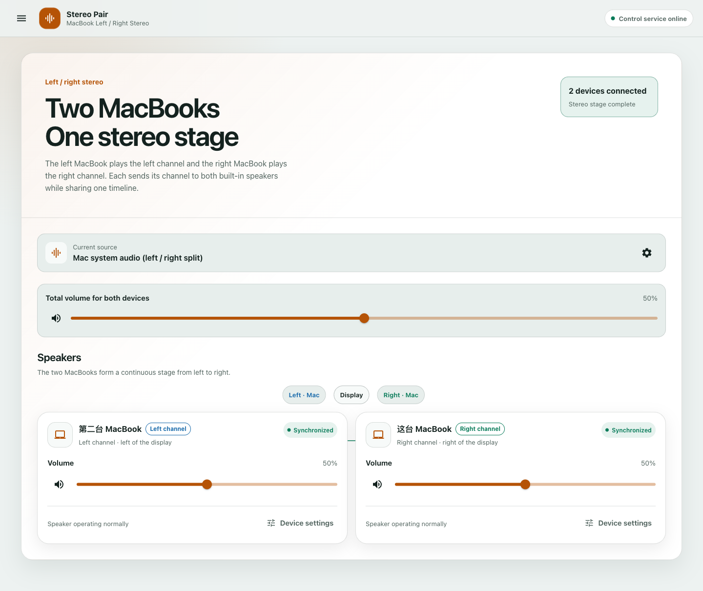

# MacBook Stereo Pair for macOS

> Two MacBooks. One synchronized left/right stereo stage.

[](https://github.com/damoqiongqiu/snapcast-stereo-pair/actions/workflows/ci.yml)
[](LICENSE)

MacBook Stereo Pair turns two MacBooks into a synchronized left/right listening
stage. The source Mac captures its system audio once, splits it into two mono
streams, and sends each stream to the MacBook on the corresponding side of the
desk. Playback on both Macs follows one Snapcast clock.



## What It Does

- Captures macOS system audio through BlackHole and PortAudio.
- Publishes lossless `LeftAudio` and `RightAudio` PCM streams.
- Runs Snapserver and the local Snapclient as per-user launchd services.
- Binds the local client explicitly to the built-in speaker while system audio
  continues to flow through BlackHole.
- Applies listening volume in CoreAudio after decoding, leaving the received
  PCM chunks at full scale.
- Ships a native SwiftUI menu-bar console with a dual-channel layout, live
  meters, health LEDs, mode switching, first-run setup, bilingual resources,
  and redacted diagnostics.
- Installs and configures a remote Snapclient over SSH without storing a
  password.
- Uses stable role names and stream-based routing, so client IDs and left/right
  placement are configurable.
- Works with the optional browser diagnostics controller in
  [snapweb-stereo-pair](https://github.com/damoqiongqiu/snapweb-stereo-pair).

The validated reference setup uses 48 kHz / 24-bit mono PCM, 20 ms chunks, and a
200 ms buffer for each stream.

## How the Two Projects Fit Together

```text
snapcast-stereo-pair
  audio capture
  left/right stream publication
  Snapcast server and clients
  launchd services
  native macOS console and control Agent
  installation and pairing
              |
              | local Snapserver control API
              v
snapweb-stereo-pair
  optional browser diagnostics
  bilingual presentation
  pair status and controls
```

This repository is the required audio runtime and owns the primary native
interface. `snapweb-stereo-pair` is an optional browser interface and does not
capture, transport, or output audio by itself.

You can run the runtime without the browser controller. The controller cannot
produce a stereo-pair system unless this runtime is installed and running.

The compatible first release is:

- `snapcast-stereo-pair` `v0.2.0`
- `snapweb-stereo-pair` `v0.1.0`

## Architecture

```text
macOS system audio
        |
        v
BlackHole 2ch
        |
        | PortAudio, 10 ms capture callbacks
        v
snapcast-capture-blackhole
        |
        +---- left.pcm FIFO ----> LeftAudio ----> left-side Mac
        |
        +---- right.pcm FIFO ---> RightAudio ---> right-side Mac
```

One PortAudio process reads BlackHole and writes both mono FIFOs from the same
capture callback. Snapserver timestamps both streams with one server clock.
Each Snapclient expands its mono stream to the two channels of its local output
device. See [docs/architecture.md](docs/architecture.md) for the timing,
clocking, FIFO, and recovery details.

The native app and CLI connect to a per-user `StereoPairAgent` over an
owner-only Unix socket. Closing the GUI does not stop the independent launchd
audio engine. See [docs/native-console.md](docs/native-console.md).

## Requirements

- Two Macs running macOS 14 or newer.
- Both Macs on the same trusted LAN, or connected through a trusted VPN.
- The same CPU architecture on both Macs when using the included remote
  installer to copy the locally built Snapclient binary.
- Homebrew, Xcode Command Line Tools, and the build dependencies listed below.
- [BlackHole 2ch](https://github.com/ExistentialAudio/BlackHole) on the source
  Mac.
- `SwitchAudioSource`, PortAudio, and the Snapcast build dependencies on the
  source Mac.
- SSH key authentication from the source Mac to the remote Mac for unattended
  remote installation.

The primary validated environment is a pair of MacBook Pro `Mac16,1` systems
with Apple M4 (arm64), 24 GB and 16 GB memory, running macOS 27.2.1 (26B131).
The source Mac uses BlackHole 2ch 0.7.1 and PortAudio from Homebrew. Hardware
validation covers cold start, native-mode switching, sleep/wake recovery with
both systems, and independent `vmvc`/`volm` volume restoration.

## Install BlackHole

On the Mac that will capture audio:

```sh
brew install --cask blackhole-2ch
brew install switchaudio-osx portaudio cmake ninja pkgconf boost openssl@4 \
  flac libogg libsoxr libvorbis opus
```

The capture path expects the output device named `BlackHole 2ch`. Restart audio
applications after installing BlackHole so they can see the virtual device.

## Configure the Pair

Clone both repositories beside each other if you plan to use the controller:

```sh
git clone https://github.com/damoqiongqiu/snapcast-stereo-pair.git
git clone https://github.com/damoqiongqiu/snapweb-stereo-pair.git
```

On the source Mac, run the configurator from the runtime repository:

```sh
./integration/scripts/configure-pair.sh
```

It creates:

```text
~/.config/snapcast-stereo-pair/pair.env
```

The file is ignored by Git and stores the SSH target, source address, physical
left/right placement, device identifiers, and stable client role names. Blank
`SOURCE_HOST` values are resolved from the active primary IPv4 interface.
Environment variables override values read from the file.

Use `--force` to replace an existing configuration. Use `--print` to render the
resolved values without writing them. Never publish `pair.env`; it can contain
private network information.

## Install the Runtime

On the source Mac, run the product installer:

```sh
./integration/scripts/install-product.sh
```

This builds and installs the audio runtime, native application, control Agent,
CLI, LaunchAgents, scripts, and setup helper. Re-running it is safe: matching
files are left untouched, missing or modified files are repaired, and a newer
version is treated as an upgrade.

The installer records its state at:

```text
~/Library/Application Support/Snapcast/state/installation.json
```

The manifest stores the product version, control protocol version, configuration
schema, installation source, and file digest.

The app is installed at:

```text
~/Applications/MacBook Stereo Pair.app
```

Launch it to use the first-run wizard. The wizard checks dependencies, hands
password-requiring work to Terminal, configures SSH key authentication, and
verifies both channel routes before opening the console. The app never reads or
stores an SSH password.

If automatic detection is wrong, or a clean rebuild is required, use **Advanced
Diagnostics → Installation maintenance → Force reinstall current version**, or:

```sh
./integration/scripts/install-product.sh --force-reinstall
```

Force reinstall replaces all program and service files. It preserves
`pair.env`, remote control configuration, logs, and user preferences. Clearing
configuration is a separate destructive operation.

Install the remote client from the same source Mac:

```sh
./integration/scripts/install-remote.sh
```

The remote install copies the patched Snapclient, wake listener, and both
LaunchAgents. The remote Mac does not need BlackHole or the Snapserver. It must
already accept your SSH key.

Check the pair:

```sh
./integration/scripts/check-health.sh
```

See [docs/installation.md](docs/installation.md) for prerequisites, device
identifiers, manual configuration, and health validation.

## Install the Optional Browser Interface

The native console is the primary interface. Snapweb remains useful for
diagnostics while native feature parity is completed. With both repositories
cloned beside each other:

```sh
./integration/scripts/install-snapweb.sh
```

Set `SNAPWEB_SOURCE` if the interface checkout is elsewhere. The installer runs
the controller checks, deploys its production build, and serves it locally at:

```text
http://127.0.0.1:1780
```

## Audio and Network Model

- Capture device: BlackHole 2ch.
- Hardware level: BlackHole and both built-in speakers are kept at 100%.
- Internal capture format: 48 kHz, 32-bit float.
- Stream format: 48 kHz / 24-bit / mono PCM for each side.
- Capture callback: 10 ms.
- Snapcast chunk: 20 ms.
- Stream buffer: 200 ms.
- Codec: uncompressed PCM.
- Stream listening port: TCP `1704`.
- HTTP controller and TCP control APIs: localhost only.
- Approximate PCM payload: 192,000 bytes/s or 1.54 Mbit/s per mono stream.
- Listening volume: CoreAudio AudioQueue parameter, after PCM decoding and
  channel expansion; the integer stream buffer is not attenuated.

The 200 ms buffer was the lowest stable setting on the validated Wi-Fi setup.
150 ms produced occasional underruns, and 100 ms produced immediate
discontinuities in that environment.

Hardware volume is normalized before the services start and after wake. In pair
mode, changing the macOS output-volume slider while BlackHole is selected only
changes the capture level; it does not represent the built-in speaker volume.
Use the controller's total or per-device volume for normal listening.

## Operations

The runtime uses these per-user LaunchAgent labels:

```text
com.snapcast.route
com.snapcast.server
com.snapcast.splitter
com.snapcast.local-client
com.snapcast.pairing
com.snapcast.remote-client
com.snapcast.wake-recovery
com.snapcast.remote-wake-recovery
com.snapcast.control-agent
```

The control Agent runs on the source Mac independently from the GUI.
`com.snapcast.remote-client` and `com.snapcast.remote-wake-recovery` are
installed only on the remote Mac. Switch between the stereo pair and normal
local audio in the app, menu bar, or:

```sh
~/Library/Application\ Support/Snapcast/set-mode.sh snapcast
~/Library/Application\ Support/Snapcast/set-mode.sh native
```

`native` stops and disables the local Snapcast services and restores the
configured built-in output. `snapcast` re-enables them and restores BlackHole as
the system output. The generated `set-mode.sh` contains the resolved device UIDs
from your configuration.

The CLI exposes the same Agent state:

```sh
~/Library/Application\ Support/Snapcast/bin/mac-stereo-pairctl status --json
~/Library/Application\ Support/Snapcast/bin/mac-stereo-pairctl diagnostics
```

Logs are written under:

```text
~/Library/Logs/Snapcast/
```

Inspect a local service with:

```sh
launchctl print gui/$(id -u)/com.snapcast.server
```

## Troubleshooting

- Run `./integration/scripts/check-health.sh` first.
- Confirm the controller shows both `LeftAudio` and `RightAudio`.
- Confirm only the intended client is connected to each stream.
- Check that BlackHole is the source Mac's selected output in snapcast mode.
- Check FIFO permissions and recent launchd logs if either stream is missing.
- If one side is reversed, change `LEFT_IS_REMOTE` and reinstall the routing
  configuration.
- If audio drops out, inspect the 200 ms buffer and recent underrun warnings.
- If audio breaks after sleep, verify both wake-recovery LaunchAgents are
  running.
- If one side is quieter, run the health check and confirm both hardware levels
  are 100% before changing Snapcast volume.
- Use Advanced Diagnostics in the native app for service state, versions,
  redacted export, and logs.

See [docs/troubleshooting.md](docs/troubleshooting.md) for recovery commands.

## Security

TCP stream port `1704` has no built-in authentication. Run this project only on
a trusted LAN or behind a trusted VPN/firewall. Do not expose port `1704`
directly to the internet.

Snapserver HTTP on `127.0.0.1:1780` and TCP control on `127.0.0.1:1705` are
localhost-only. The installers never store an SSH password. Keep `pair.env`,
logs, credentials, and private network addresses out of issues and commits.

The native control socket is local-only and mode `0600`. The Agent validates
the peer UID, accepts only fixed protocol commands, and allowlists service
maintenance IDs. Diagnostics are redacted by default and are never uploaded.

This project does not disable Gatekeeper, SIP, or any other macOS security
feature.

## Uninstall and Rollback

Return to normal local audio:

```sh
~/Library/Application\ Support/Snapcast/set-mode.sh native
```

Stop the local services while keeping the installed files:

```sh
./integration/scripts/uninstall-local.sh
```

Remove only the native app, Agent, and CLI without stopping audio:

```sh
./integration/scripts/uninstall-native.sh
```

To remove the local installation completely, run the uninstall script and then
remove the generated support, log, and LaunchAgent files described in
[docs/installation.md](docs/installation.md). Remove the remote client only
after confirming its resolved remote path and user.

## Compatibility

| Component | First public release | Upstream base |
| --- | --- | --- |
| Runtime and native console | `v0.2.0` | Snapcast `v0.35.0` |
| Optional browser controller | `v0.1.0` | Snapweb `v0.9.3` |

The native console follows the runtime repository. Use a `v0.1.x` browser
controller with the `v0.1.x` runtime until the optional Snapweb controller is
updated for the native-first `v0.2.0` release.

## Development

```sh
./integration/scripts/build-macos.sh
swift test --package-path native
swift build --package-path native -c release
integration/test/test-pair-config.sh
integration/test/test-audio-levels.sh
integration/test/test-pair-routing.sh
integration/test/test-wake-recovery.sh
integration/test/test-control-plane.sh
integration/test/test-mode-transitions.sh
integration/test/test-install-lifecycle.sh
integration/test/test-control-agent-install.sh
integration/test/test-native-app-packaging.sh
integration/test/test-homebrew-formula.sh
zsh -n integration/scripts/*.sh integration/test/*.sh
plutil -lint integration/launchagents/*.plist.in
```

For the upstream Snapcast test executable, configure a test build and run:

```sh
cmake -S . -B .build-tests -G Ninja -DBUILD_SERVER=OFF -DBUILD_CLIENT=ON \
  -DBUILD_TESTS=ON -DBUILD_WITH_SSL=OFF -DBUILD_SHARED_LIBS=OFF
cmake --build .build-tests
./bin/snapcast_test --reporter compact
```

## Contributing

Read [CONTRIBUTING.md](CONTRIBUTING.md), [SECURITY.md](SECURITY.md), and the
repository instructions in [AGENTS.md](AGENTS.md). Hardware validation remains
a manual release gate because CI cannot create a two-MacBook audio setup.

## License and Upstream

This is an unofficial macOS stereo-pair fork maintained by `damoqiongqiu`, not
an official Snapcast release. It preserves the upstream Snapcast history and
source notices and is distributed under GPL-3.0-or-later. See
[NOTICE.md](NOTICE.md), [README.snapcast.md](README.snapcast.md), and
[LICENSE](LICENSE).

Native source and Homebrew installation are documented in
[docs/installation.md](docs/installation.md),
[docs/native-console.md](docs/native-console.md), and
[docs/homebrew.md](docs/homebrew.md).

