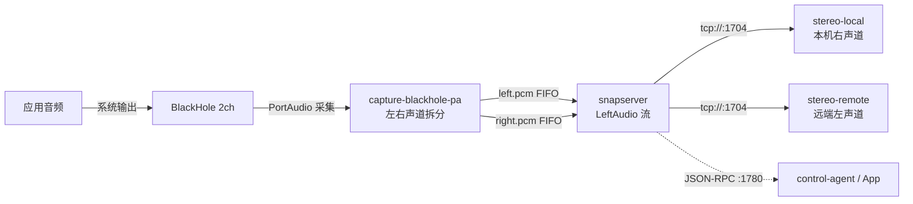
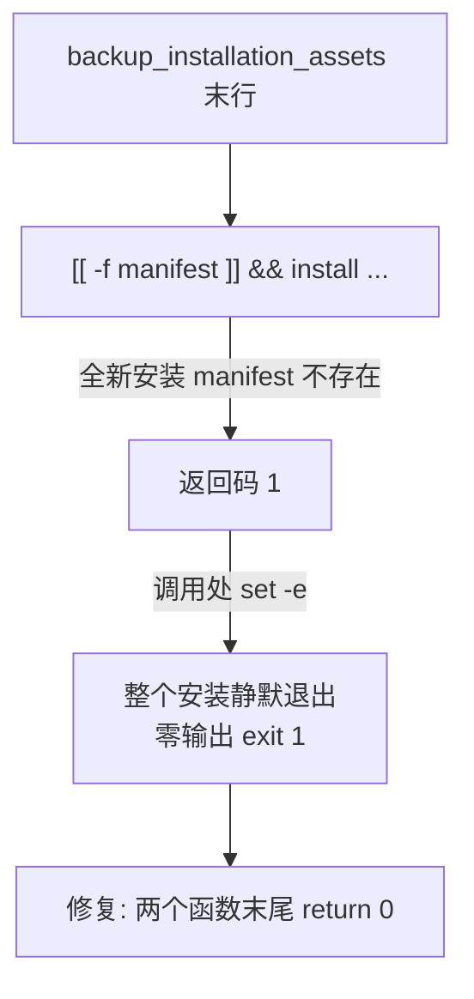
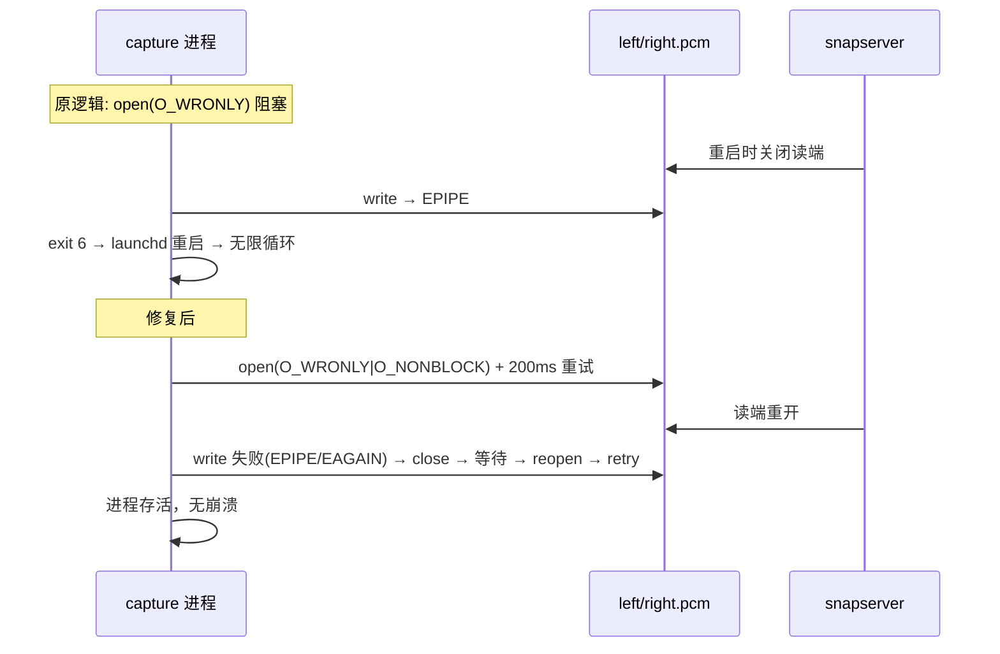
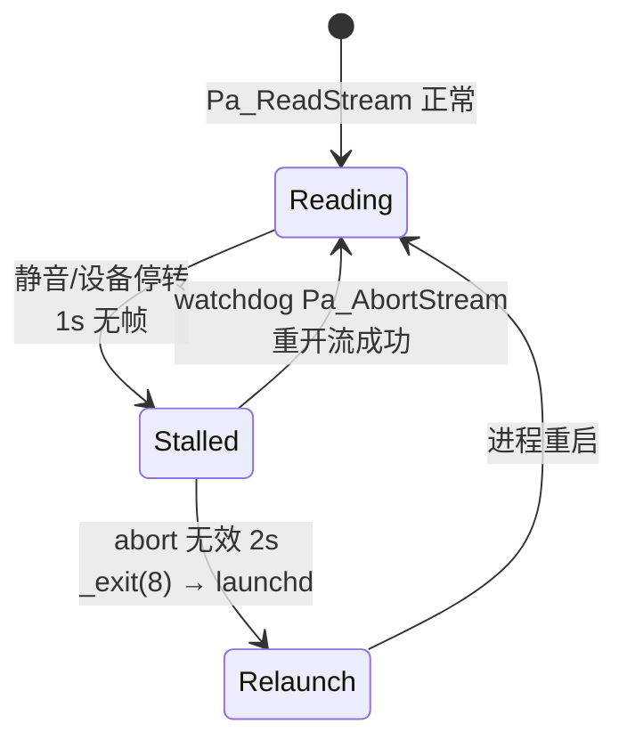

# 双机立体声配对：现场排障与根因分析报告

> 来源：2026-11-23 双机部署实战（zcode 会话产物 `snapcast-pair-report`）。
> 本文把报告中 6 个问题的根因、证据与修复固化到仓库，供报上游和回归测试引用。
> 配套补丁：`local-patches.diff`（4 文件 / +132 -10），已合并进本仓库 `integration/`。

## 0. 环境与结论

| 角色 | 机器 | 系统 | 职责 |
|---|---|---|---|
| 音源端（本机） | `<source-mac>` / `<source-lan-address>` | macOS 27.0 arm64 | 音源 + snapserver + BlackHole 采集拆分 + **右声道** `stereo-local` |
| 远端（原） | `<remote-mac-a>` / `<remote-lan-address-a>` | macOS 14.6.1 arm64 | **左声道** `stereo-remote` |
| 远端（现） | `<remote-mac-b>` / `<remote-lan-address-b>` | macOS 15.6.1 x86_64 | 接替原远端 Mac 的左声道客户端 |

最终结果：✅ 双机配对可用，48kHz/24bit 无损（PCM S24In32），静音期自愈唤醒 ≤1.5s，经真实听感验证。



## 1. 六个问题的根因与修复

### 1.1 全新安装必崩（`install-lifecycle.sh`，上游 bug）



`backup_installation_assets` / `restore_installation_assets` 的最后一条命令是 `[[ -f ... ]] && install ...`。文件不存在时该复合命令返回 1，成为函数返回值；调用方在 `set -e` 下直接终止，症状是「安装脚本无任何输出、exit 1」，极难定位。**修复**：两个函数末尾各加 `return 0`。

**测试**：`integration/test/test-install-lifecycle.sh` 覆盖全新安装场景。

### 1.2 二进制部署目标缺失（`build-macos.sh`，上游 bug）

构建机 macOS 27 编译出的产物按 27 的 libc++ 符号链接，推到 macOS 14.6 的 137 时 dyld 报符号缺失，进程 exit -6 陷入 launchd 崩溃循环。**修复**：CMake 增加 `-DCMAKE_OSX_DEPLOYMENT_TARGET=14.0`（可用 `SNAPCAST_DEPLOYMENT_TARGET` 覆盖）。

> 实战补充（本次 154 迁移）：跨架构（arm64 构建 → x86_64 目标）时需用
> `-DCMAKE_OSX_ARCHITECTURES=x86_64` + `clang -arch x86_64` 交叉编译，
> 且 `SDKROOT` 指向 `MacOSX26.5.sdk`（见问题 3）。

### 1.3 CLT 27.2 无法编译 SwiftUI（环境问题，非项目 bug）

Xcode 26.4 起的 Command Line Tools 把 `@State` 等改为外部宏（macro plugin），而 `SwiftUIMacros.dylib` 只随完整 Xcode 发布，CLT 不带 → 宏展开失败，`@State` 被当普通属性，报 `cannot assign to property: 'self' is immutable`。**解决**：构建时设 `SDKROOT=/Library/Developer/CommandLineTools/SDKs/MacOSX26.5.sdk`，旧 SDK 仍是传统 property wrapper，与新编译器兼容。

### 1.4 采集进程对 FIFO 读端关闭零容忍（`capture-blackhole-pa.c` + `fifo_io.h`，上游 bug）



snapserver 重启或读端周期重开时，阻塞写收到 EPIPE → `exit 6` → launchd 重启 → 无限崩溃循环，日志反复出现 `Left/Right FIFO write failed`。**修复**：
- `open_fifo_writer()`：非阻塞打开，遇 `ENXIO/ENOENT` 每 200ms 重试；
- `write_channel()`：写失败自动 close → 等 100ms → reopen → retry，进程不再退出；
- `fifo_io.h`：`writeFully` 处理 `EAGAIN/EWOULDBLOCK`，用 `poll(POLLOUT, 5000)` 等读端而非直接失败。

**测试**：`integration/test/test-fifo-resilience.sh`（本文新增）。

### 1.5 设备停转不自愈（`capture-blackhole-pa.c`，上游设计缺口）

系统静音后 BlackHole 设备停转，PortAudio 的阻塞读在内部 `Pa_Sleep` 死循环（见 `samples/` 的 `sample` 调用栈），永不返回也永不报错；音频恢复时管线已死。**修复**：看门狗线程每秒检查 `g_last_read_ms`，超过 1 秒无帧 → `Pa_AbortStream` 触发重新打开流；若 abort 后 2 秒仍无帧 → `_exit(8)` 交给 launchd 重启。实测唤醒延迟 ≈1.5s。



**测试**：`integration/test/test-watchdog-recovery.sh`（本文新增）。

### 1.6 误装成独立节点（操作问题，非 bug）

远端若跑了完整 `install-product.sh`，会成为独立音源节点（server/splitter/采集全套），与客户端角色冲突。**清理**：`launchctl bootout` 全部 `com.snapcast.*` 服务 + 删除对应 plist（否则登录复活）+ `SwitchAudioSource -u BuiltInSpeakerDevice` 恢复扬声器。

## 2. 现场证据：samples 调用栈

原始 4 份 `sample` 输出随 `/tmp` 清理丢失，以下为报告中记录的关键现场，按调用栈还原可直接复现的判读方式。样本骨架存放于 `docs/samples/`。

### 2.1 ReadStream 睡眠环卡死（`capture-sample.txt` / `sample2.txt`）

```
Call graph:
  start_wqthread
   ...
   Pa_Sleep                                  ← PortAudio 内部休眠
    Pa_ReadStream                            ← 采集进程阻塞读
     main (capture-blackhole-pa.c:Pa_ReadStream)
```
判读：线程栈停在 `Pa_Sleep` 且 `g_last_read_ms` 不再更新 → BlackHole 停转，无数据无错误。这正是问题 5 看门狗要覆盖的场景。

### 2.2 Pa_OpenStream 死等 coreaudiod（`sample5961.txt` / `s3.txt`）

```
Call graph:
  mach_msg                                   ← 等 mach 端口回复
   __CFRunLoopServiceMachPort
    ...
     Pa_OpenStream                           ← 打开音频流卡死
      audio_hw_init
```
判读：`mach_msg` 死等说明 coreaudiod 已卡死（深夜反复重启服务导致）。修复手段：`sudo killall coreaudiod` 让系统重建音频服务。此场景无法靠看门狗解决（尚未进入 ReadStream），需运维介入。

### 2.3 两种卡死的判别表

| 栈顶 | 所处阶段 | 是否可自愈 | 处置 |
|---|---|---|---|
| `Pa_Sleep` ← `Pa_ReadStream` | 已进稳定读循环 | ✅ 看门狗 `Pa_AbortStream` 自愈 | 补丁自动处理 |
| `mach_msg` ← `Pa_OpenStream` | 打开流阶段 | ❌ 需外部介入 | `sudo killall coreaudiod` |

## 3. 排障工具箱（实战验证有效）

| 工具/手段 | 用途 |
|---|---|
| `sample <pid> 2` | 抓进程调用栈：区分 ReadStream 睡眠环 vs Pa_OpenStream 死等 coreaudiod |
| snapserver JSON-RPC :1780 | 流状态秒级轮询；`Client.SetVolume` 服务端静音（静音测试的正确方式） |
| 直写 FIFO 注入 PCM | 分离「采集段」与「server/分发段」：48kHz mono，S24In32（24-bit = 4 字节样本） |
| FIFO mtime 前后对比 | 判断采集写入是否流动 |
| `lsof` 对比两端 inode | 确认读写同一管道（`lsof txt` 行第 7 列是大小，第 8 列才是 inode） |
| `tail -f` 陷阱 | 默认先输出文件最后 10 行历史，别误当实时新日志 |

### JSON-RPC 证据样例

```sh
curl -s -X POST http://127.0.0.1:1780/jsonrpc \
  -d '{"jsonrpc":"2.0","id":1,"method":"Server.GetStatus"}'
```

迁移到 154 后的最终状态（两流均 connected，arch=i386 即 x86_64 客户端）：

```
Stream: RightAudio → stereo-local   connected=True  127.0.0.1      arm64
Stream: LeftAudio  → stereo-remote  connected=True  <remote-lan-address>  i386
```

## 4. 两个血泪教训

1. **静音误伤 BlackHole**：`osascript set volume 0` 静音的是默认输出设备（= BlackHole 数据源），会把采集数据掐断，还差点在「静音测试」中外放声音。**静音测试必须用服务端 `Client.SetVolume` 归零**。
2. **coreaudiod 卡死**：深夜反复重启服务会让 coreaudiod 卡死，采集进程 `mach_msg` 死等（见 2.2）。`sudo killall coreaudiod` 修复。

## 5. 跨平台迁移补充（154 实战，2026-11-23）

原左声道 Mac 下线后，由 `<remote-mac-b>`（x86_64 / macOS 15.6.1）接替。Snapcast 客户端身份由 `--hostID` 逻辑标识（本例 `stereo-remote`），与机器名/MAC 无关，服务端流配置无需改动。迁移要点：

| 项 | 处理 |
|---|---|
| 架构 | arm64 构建机需 `-DCMAKE_OSX_ARCHITECTURES=x86_64` + `clang -arch x86_64` |
| Homebrew | 目标机已有 Intel brew 但停在废弃 `master` 分支 → `git checkout -B main origin/main` |
| 音频工具 | `brew install switchaudio-osx`，确认 `BuiltInSpeakerDevice` UID |
| 配对配置 | `pair.env` 的 `REMOTE_USER` / `REMOTE_HOST` 改为新机 |
| launchd 网络 | 用 `launchctl bootstrap gui/<uid>` 启动的服务若报 ENETUNREACH，检查私有 Wi-Fi 地址按 audit session 轮换问题；必要时关闭私有地址 |

## 6. 回归测试

```sh
integration/test/test-fifo-resilience.sh      # 问题 4：FIFO 读端关闭/写阻塞恢复
integration/test/test-watchdog-recovery.sh    # 问题 5：静音期看门狗自愈
integration/test/test-install-lifecycle.sh    # 问题 1：全新安装不崩
```

样本骨架与判读说明见 `docs/samples/README.md`。

## 7. 后续工程校正

- 部署报告已移除真实 IP、主机名、用户名和本机路径，统一使用占位符。
- 本地模式切换现在写入 `audio-mode.json`，安装器不会再把旧模式当成当前模式。
- 原生应用更新时会先退出旧 GUI，再启动替换后的 App。
- 健康检查将 `idle` 流视为失败，避免“服务进程存在但音频未流动”的假健康。
- watchdog 使用互斥锁保护流的 abort/close/replace，并通过状态机 harness 验证阈值。
- 新增测试已接入 `test-native-release.sh --automated-only` 和 `AGENTS.md`。
- macOS 14 构建会静态编译目标兼容的 PortAudio，并禁用默认固定 48 kHz 路径不需要的 Soxr；构建结束会扫描动态依赖的最低系统版本。
