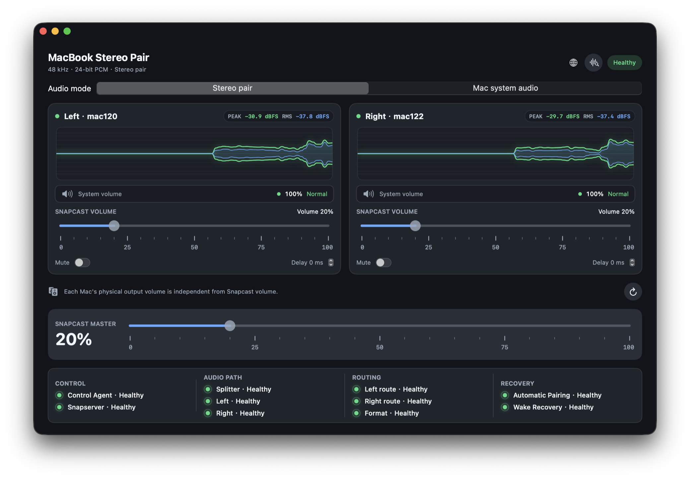
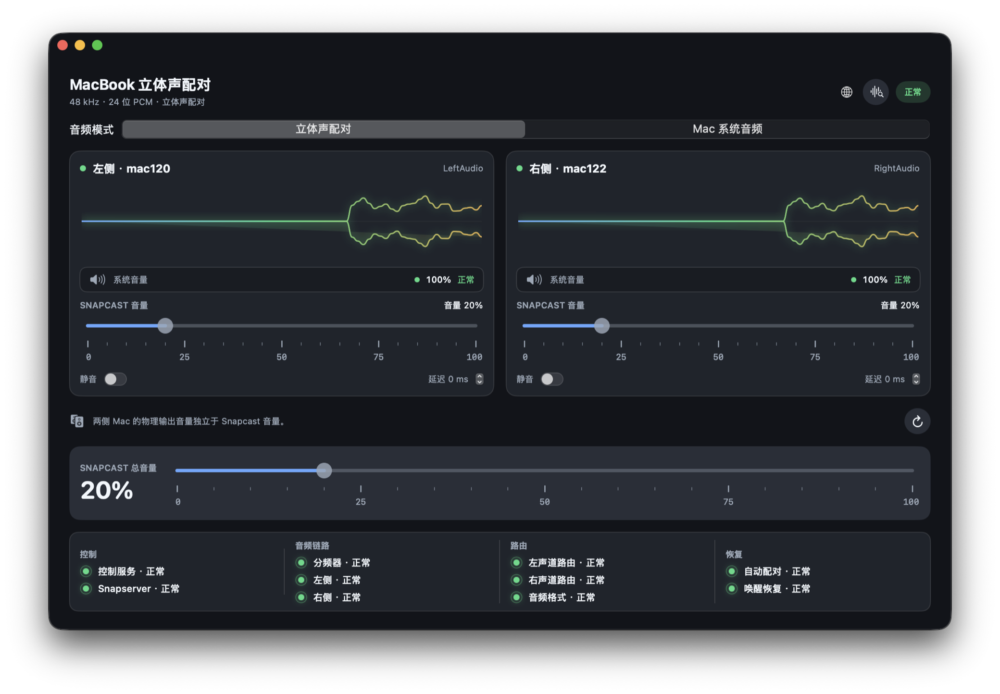

# Native macOS Console

The native application, `MacBook Stereo Pair.app`, is the primary interface for
the stereo pair. It controls and observes the audio runtime but does not carry
audio itself. Closing the window or quitting the GUI never stops playback.
Physical placement still determines the acoustic center image; follow the
[placement guidance](../README.md#32-physical-placement) before evaluating the
console's stereo presentation.



<details>
<summary>简体中文界面</summary>



</details>

## 1. Runtime and Interface Relationship

```text
MacStereoPair.app --------+
                          | Unix socket
mac-stereo-pairctl -------+------> StereoPairAgent
                                      |
                                      +---- launchctl
                                      +---- local Snapserver API
                                      +---- shared audio meters
```

The control socket is:

```text
~/Library/Application Support/Snapcast/run/control.sock
```

Its mode is `0600`, and connections from another user are rejected. HTTP and
TCP control APIs remain bound to localhost. Uncompressed audio port `1704`
requires a trusted LAN, VPN, or restrictive firewall.

## 2. Two Audio Modes

The high-level modes are:

- **Stereo pair**: BlackHole captures macOS output, the splitter creates
  `LeftAudio` and `RightAudio`, and both Snapclients play their assigned side.
- **Mac system audio**: the runtime is stopped, services are intentionally
  disabled, and the last non-BlackHole output is restored. If that device is no
  longer available, the configured built-in speaker is used.

When switching back to the stereo pair, the runtime restarts the splitter once
after all services are running. This releases BlackHole input from the silent
device state that can survive the Native-to-Snapcast route change.

The exact physical output volume is restored before switching back. This applies
to both Macs and prevents a hand-back transition from unexpectedly jumping to
100%.

BlackHole remains installed in system mode. It is only made inactive by the
audio route, and the runtime never unloads or deletes the driver.

The application appears in both the Dock and menu bar. The menu-bar menu provides
the current status, console access, stereo-pair/system-mode switching, the
current master-volume readout, and Quit Interface. Mute, reconnect, and latency
controls remain in the main console.
The main window provides:

- master volume with preserved left/right offsets;
- per-side Snapcast volume, mute, delay, route, format, and connection state;
- each Mac's physical output volume with normal, low, unread, and stale states;
- live peak/RMS waveform meters and clip indication;
- service, routing, and wake-recovery status;
- an advanced sheet for logs, redacted export, versions, diagnostics, and
  allowlisted service restarts.

The main console does not use a scrolling viewport. Its minimum and default
content size is 1040 × 660, so every waveform, volume, master, and status card
remains visible; the maximum size is 1240 × 860. Content is capped at 1120
points and centered inside larger windows, so cards do not stretch without
limit. Saved window positions that fall outside the available displays are
recentered automatically.

Only one GUI process may run for the current user. Launch Services is configured
to reject duplicate application instances, and the app also holds a user-level
file lock for direct binary launches. Opening the app again activates the
existing console instead of creating another menu-bar process.

Snapcast volume sliders update locally for every pointer movement. During a
sustained drag, serialized audio previews are sent a few times per second rather
than once per movement. Releasing the pointer sends the final rounded value
after any in-flight preview completes. A direct click moves the handle
immediately and coalesces its asynchronous update. This keeps the knob
responsive even while the 250 ms visible-window status refresh is still
returning the previous volume. Out-of-order status responses are discarded, so
an older poll cannot
overwrite the committed value and make the knob jump backward. Each slider has
5% reference ticks, with longer and labeled marks at 0%, 25%, 50%, 75%, and
100%. The scale shares the slider track endpoints so neither end protrudes
beyond the other.

## 3. Health and Notifications

Health is reported independently from the selected audio mode. Expected stops
in system mode are shown as disabled rather than failed.

A Snapcast client is considered connected only when the server reports it
connected and its most recent heartbeat is no newer than six seconds. This
detects a network loss before the operating system closes the TCP connection.
The disconnected channel remains visible with a red status, its waveform is
cleared, and the overall health changes to degraded.

The notification rules use grace periods:

- local service failures settle for 3 seconds;
- a disconnected client settles for 6 seconds;
- wake recovery has up to 30 seconds to complete.

One incident produces one notification. Repeated snapshots do not repeat it.
When the affected component recovers, the incident resets so a later failure can
notify again. Notification permission is requested only after setup succeeds,
not when the application launches.

If alerts do not appear, verify **System Settings → Notifications → MacBook
Stereo Pair**. The console still reports health without notification permission.

Automatic Pairing is a periodic task that exits successfully after each check.
Its launchd state is therefore normally inactive between 15-second runs. A
successful pairing marker keeps the row marked healthy for up to 45 seconds;
failed, stale, or never-successful checks remain warnings or failures.

## 4. First-Run Setup

The wizard has four persistent stages after the welcome page:

1. dependency checks;
2. local runtime installation;
3. remote Mac connection;
4. final verification.

Checks cover Xcode Command Line Tools, Homebrew, BlackHole, PortAudio, OpenSSH,
the control Agent, and installed runtime files. Homebrew is probed at both:

```text
/opt/homebrew/bin/brew
/usr/local/bin/brew
```

Passwords are entered only in Terminal. The app generates a fixed-argument
script, opens it with Terminal, and polls for completion. It never reads or
stores a local administrator password or a remote SSH password.

The remote step creates or reuses an SSH key, uses `ssh-copy-id` only when
needed, verifies key-only access with `BatchMode=yes`, installs the remote
helper, and writes a local non-secret `remote-control.json`.

If setup or capture succeeds but no waveform appears, check microphone/audio
input permission for `snapcast-capture-blackhole` on the source Mac, especially
after a force reinstall. The complete permission checklist is in
[troubleshooting.md](troubleshooting.md#1-permission-and-privacy-checks).

## 5. Diagnostics and Privacy

Redacted diagnostics remove home paths, SSH targets, IP addresses, and token-like
values. The export is created only after an explicit user action and is never
uploaded automatically.

The service maintenance action accepts only the fixed runtime LaunchAgent IDs.
The protocol never accepts an executable path or shell fragment.

## 6. Languages and Accessibility

English and Simplified Chinese resources ship with the application. English is
the default for new installations, while an existing saved language choice is
preserved. The language menu exposes only English and Simplified Chinese.

Status LEDs always include text or accessibility labels. Reduce Motion stops LED
pulses while preserving the semantic status. The main controls expose VoiceOver
labels and keyboard actions.

## 7. Volume and Waveform Controls

Side and master Snapcast sliders follow the pointer continuously for smooth
dragging. The visible percentage and committed Snapcast value use whole-percent
precision. Drag previews are throttled and serialized, while the final value is
trailing-debounced after release. Direct clicks jump the handle immediately and
submit one coalesced update. Periodic status polling pauses during the drag,
then resumes after the final value is acknowledged. The waveform is
data-driven and does not add decorative motion unrelated to the audio level.
Visible windows poll four times per second; hidden, minimized, or fully
occluded windows drop to once per second to avoid unnecessary background UI
work.
The displayed envelopes and Peak/RMS readout apply the current Snapcast channel
volume and mute state. High-level peaks move from green through amber toward
red, while the readout sits in the channel title row so it never covers the
waveform.
The handle center, track endpoints, and scale marks use one shared inset
geometry, so the handle is centered on the active scale position at every
volume.
VoiceOver and keyboard increment and decrement actions move one percentage
point at a time. Keyboard focus styling appears only for keyboard interaction
and is suppressed during pointer drags. Master-volume writes are serialized,
and Snapserver JSON-RPC requests use short connections so a reused keep-alive
connection cannot return an empty response and leave one channel behind.

## 8. System Volume Observation

Snapcast volume and the macOS physical output volume are separate controls. The
console labels them independently so an accidentally reduced speaker volume is
not mistaken for a Snapcast or routing failure.

The local physical output is read every 2 seconds. The remote physical output is
read every 30 seconds through the existing key-only SSH connection, so normal
operation does not keep an SSH session open or repeatedly connect every second.
The refresh button performs an immediate read of both sides.

Values below 100% are shown as low. A transient read failure keeps the previous
measurement and marks it stale after 60 seconds. The monitor is read-only: it
does not change either Mac's system volume, because doing so could override a
deliberate user adjustment.

The UI receives only the physical side, volume, timestamp, and a generic error
state. It does not expose SSH targets, account names, executable paths, or device
UIDs.

## 9. Packaging

Public releases build from source and are ad-hoc signed. They are not notarized,
do not require paid Apple Developer membership, have no App Store dependency,
and have no automatic updater. See [installation.md](installation.md) and
[homebrew.md](homebrew.md) for distribution details.

## 10. Reinstall and Upgrade

Installation is manifest-driven. The installer writes:

```text
~/Library/Application Support/Snapcast/state/installation.json
```

Repeated installation checks:

- product and config schema versions;
- control protocol version;
- required app, Agent, CLI, runtime, script, and LaunchAgent files;
- a digest of installed executable, generated service, pairing configuration,
  and remote control files.

An unchanged installation is left running. Missing or changed files trigger a
repair, a newer product version triggers an upgrade, and an older product
version is rejected unless the user explicitly forces a downgrade.

The user-facing force override is always available at **Advanced Diagnostics →
Installation maintenance → Force reinstall current version**. It deliberately
skips the “already installed” decision and rebuilds all program and service
files. Configuration, remote control state, logs, and preferences remain in
place. Removing configuration must remain a separate, explicit destructive
action.
